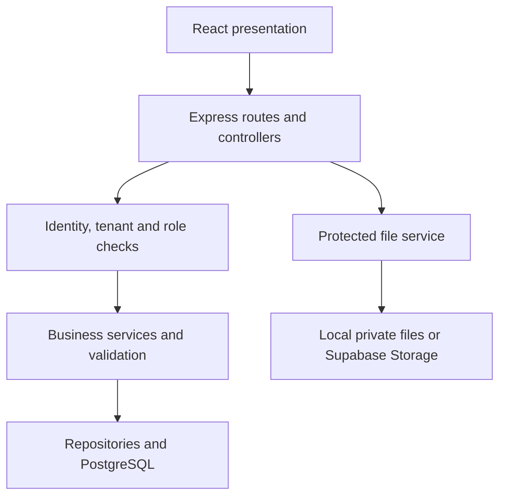
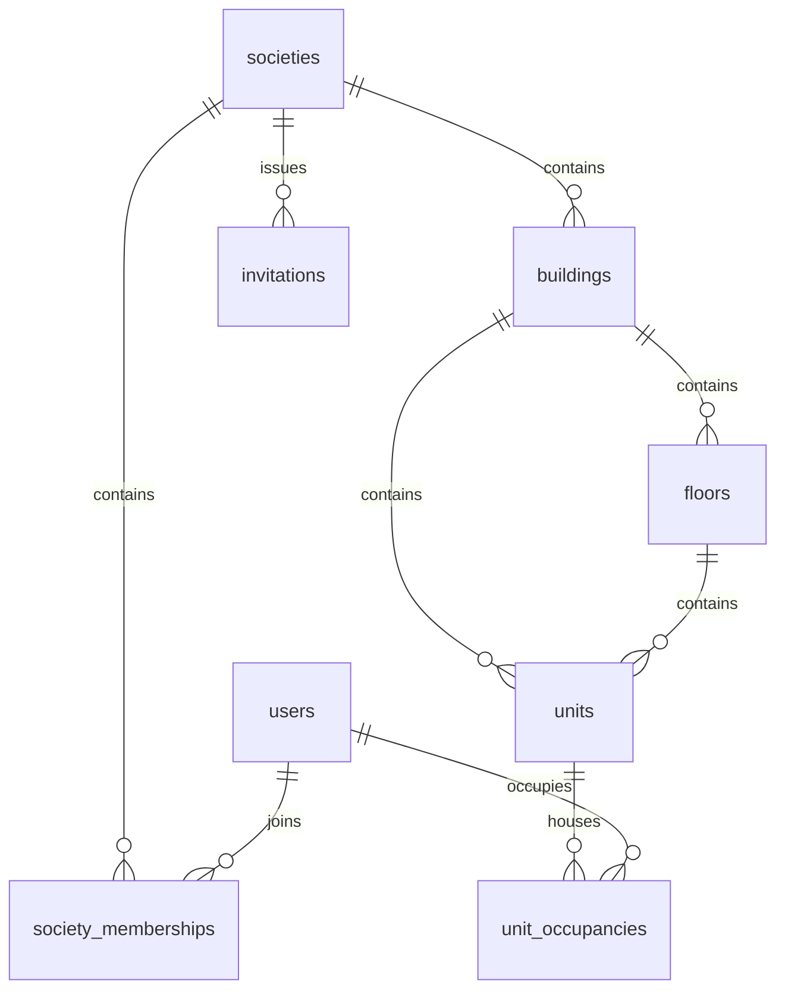
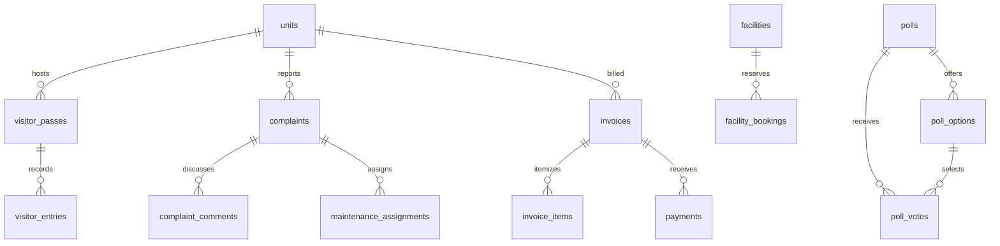
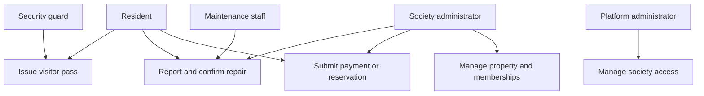

# Architecture and database reference

## Four layers

1. **Presentation:** `frontend/src/main.jsx` holds the protected information pages, shared forms, dashboard components and routes. `config.js` defines module forms/menus. `api.js` handles authenticated HTTP and Supabase sessions. CSS provides the design system and breakpoints.
2. **Application:** Express routes are deliberately co-located with small request-controller functions in `backend/src/routes`. Middleware resolves identity/membership. Zod validators reject unexpected fields.
3. **Business:** `services/operations.js` owns transitions, token validation, permission-sensitive reads, bookings and payments; `analytics.js` owns role-visible overview and reminder rules. Reporting aggregates reside beside their small request controller.
4. **Persistence:** `repositories/index.js` provides parameterized insertion, scoped record lookup, audit and notification helpers. `config/db.js` wraps persistent PGlite locally and Prisma/PostgreSQL in production. Serializable production transactions plus explicit locks protect workflows. SQL is shared between modes.

This is a modular monolith, not a microservice deployment. No extra worker is needed. Express serves API routes and can optionally serve the production frontend build. Vite proxies API traffic during development. Render and Vercel split those responsibilities online.

## Property and membership relationships

## Operational relationships

Every operational record also has a society identifier. Composite foreign keys `(society_id, related_id)` prevent references to entities in another society. IDs are random UUID strings stored as text. Database checks enforce positive amounts and sensible time intervals. The full executable schema, indexes, triggers and RLS statements are in `backend/prisma/migrations/202610170001_init/migration.sql`.

## Use cases

## Tables by concern
| Concern | Tables |
|---|---|
| Identity | users, profiles, sessions |
| Tenancy | societies, society_memberships, invitations |
| Property | buildings, floors, units, unit_occupancies |
| Gate | visitor_passes, visitor_entries, security_incidents, shifts |
| Maintenance | complaints, complaint_comments, maintenance_assignments, maintenance_updates |
| Finance | invoices, invoice_items, payments |
| Shared spaces | facilities, facility_bookings |
| Communications | announcements, announcement_reads, notifications |
| Community | polls, poll_options, poll_votes, community_events, feedback, lost_found_reports, emergency_contacts |
| Files | documents |
| Platform | subscription_plans, society_subscriptions, support_requests, audit_logs, automation_jobs |

`announcement_reads`, `maintenance_updates`, and `automation_jobs` are reserved normalized tables; the current UI uses per-user notification read markers, complaint comments and external idempotent reminder scheduling respectively. Do not confuse table presence with a completed independent workflow.

## Security boundaries
- The client never chooses its effective role. Memberships live in the database.
- Local mode hashes passwords and stores only hashes of opaque session tokens; cookies are HttpOnly/SameSite=Lax. Production local login is disabled. Role cards never authenticate a user.
- Production Supabase bearer tokens are checked by the server through Auth `getUser`; no unsigned decoding is trusted.
- RLS is enabled without browser-access policies on application tables. Privileged server SQL plus explicit tenant predicates is the intended architecture. Supabase Storage is private and proxied by authenticated routes.
- QR tokens contain 256 random bits, are stored as SHA-256 hashes, and have finite usage/time windows.
- The booking trigger locks a facility and rejects overlaps. API transactions use serializable isolation in hosted PostgreSQL; conflicts require retry.
- Amounts use bounded integer cents, with atomic payment approval and invoice updates.
- Uploaded files are size-limited and basic magic signatures are checked. Antivirus scanning is not implemented.
- Removing records with linked histories fails through foreign-key constraints. Financial and historical deletion is not offered.

## Known scale limits
Latest 500 records per module; no server pagination. Reports aggregate all relevant records. In-memory multipart uploads are limited to 5 MB/file. PGlite local transactions are serialized; it is intended for a single local process. Supabase/Prisma uses a remote PostgreSQL connection and is the intended production mode.
